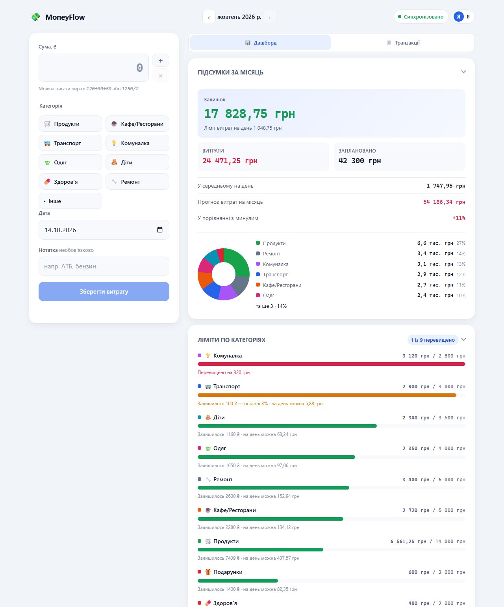

# MoneyFlow — сімейний бюджет

Програма обліку сімейного бюджету. Працює в браузері, дані лежать у
вашій Google Таблиці.

## Зміст
- [Вступ](#вступ)
- [Можливості](#можливості)
- [Як встановити](#як-встановити)
  - [1. Підготувати таблицю](#1-підготувати-таблицю)
  - [2. Розгорнути бекенд](#2-розгорнути-бекенд)
  - [3. Підключити сайт](#3-підключити-сайт)
    - [Запуск сайту локально](#запуск-сайту-локально)
    - [GitHub Pages](#github-pages)
    - [Інші статичні хостинги](#інші-статичні-хостинги)
- [Як користуватися](#як-користуватися)
  - [Додавання користувача](#додавання-користувача)
  - [Додати категорію](#додати-категорію)
  - [Встановлення бюджету на місяць](#встановлення-бюджету-на-місяць) 
  - [Як рахується бюджет](#як-рахується-бюджет)
  - [Графічний інтервейс](#графічний-інтервейс)
  - [Транзакціі](#транзакціі)
  - [Статус синхронізаціі](#статус-синхронізаціі)
- [Технічні подробиці](#технічні-подробиці)
  - [Як іде виклик: браузер і таблиця](#як-іде-виклик-браузер-і-таблиця)
  - [Як влаштована авторизація](#як-влаштована-авторизація)
  - [Що де лежить у браузері](#що-де-лежить-у-браузері)
  - [Сесія і термін життя](#сесія-і-термін-життя)
  - [Структура проєкту](#структура-проєкту)
  - [Оновлення Web App](#оновлення-web-app)
- [Якщо щось зламалося](#якщо-щось-зламалося)

Міркування, чому обрано саме такі рішення, і перелік того, що вже
перевірено тестами, — в **[AGENTS.md](AGENTS.md)**.

---

## Вступ

Програма обліку сімейного бюджету: кожна людина у сім'ї заходить під
своїм аккаунтом і записує витрати в спільний бюджет. Дані
записуються у Google Таблиці, вашого Google акаунта і залишаються під вашим
повним контролем.

Веб сервером може виступати будь-який статичний хостінг.



*Дані на знімку вигадані.*

---

## Можливості

- **Кілька користувачів** — Витрати можуть вводити кілька користувачів. У кожного свій аккаунт. Програмно обмежено змінною MAX_TOTAL_USERS. При необхідності можно змінити.
- **Форма введення витрат завжди під рукою** — Витрати можно вводи відразу, як зайшли на сайт. Що зменшує час перебування у програмі.
- **Зручність введення витрат** — сума, категорія, дата, нотатка. Сума може приймати
  вираз: `120+80+50` або `1250/2`. Програма порахує за вас.
- **Асинхроність** — кожен новий запис потрапляє у чергу на відправлення відразу. Користувач не чекає відповіді сервера. Стан черги завжди видно у шапці.  
- **Ліміти по категоріях** — прогрес-бар, попередження за 80% і підсвічування перевищення.
- **Заплановано** — Бюджет складається з суми лімітів категорій, заданих саме для цього місяця.
- **Статистика** — витрати, середнє за день, прогноз на кінець місяця,
  динаміка до попереднього, розподіл по категоріях.
- **Транзакції** — історія операції за обраний місяць.
- **Дві теми** — можно вибрати темну або світлу тему.
- **Підтримка PWA** — можно встановити, як PWA застосунок на телефон або компьютер
- **Статистика і історія** — «Дашборд» (підсумки й ліміти) і «Транзакції»
  (список операцій). Обраний розділ запам'ятовується.
- **Безпека** — пароль ніколи не лишає браузер, на сервер іде лише хеш, а браузер тримає підписаний сервером токен.

---

## Як встановити

### 1. Підготувати таблицю

1. Створіть нову таблицю на Google Диску, назвіть, наприклад, `MoneyFlow`.
2. Відкрийте **Розширення → Apps Script**.
3. Вставте в редактор вміст файлу
   [`tools/bootstrap-sheets.gs`](tools/bootstrap-sheets.gs).
4. У самому файлі заповніть `DEMO_USERS` — логін, колір аватарки
   та **свій пароль** для кожного:

   ```js
   const DEMO_USERS = [
     { login: 'Я',       color: '#2563eb', password: 'Grivna-2026' },
     { login: 'Дружина', color: '#db2777', password: 'Kvitka-2026' },
   ];
   ```

 ⚠️ Поміняйте логін і пароль для `DEMO_USERS` і запам'ятайте його.
   Щонайменше 10 символів, мала й велика літера та цифра.
5. У списку функцій виберіть `bootstrapSheets` і натисніть **Запустити**.

Скрипт створить чотири аркуші:

| Аркуш | Призначення |
|---|---|
| `Transactions` | усі витрати; `ID, Дата, Категорія, Сума, Користувач, Нотатка, Записано`. Дата зберігається рядком `РРРР-ММ-ДДГГ:ХХ` |
| `Categories` | каталог категорій; `Назва, Іконка, Колір, Активна` |
| `BudgetLimits` | місячний бюджет; `Місяць, Категорія, Ліміт, ₴` |
| `Users` | `Ім'я, Колір, Пароль, Активний` |

Після цього видаліть `bootstrap-sheets.gs` із редактора. Він більше не знадобиться.<br>
⚠️ Не давайте доступ до проєкту Apps Script стороннім; саме він контролюєє аккаунти.

### 2. Розгорнути бекенд

У тому ж проєкті Apps Script:

1. Вставте вміст двох файлів:
   - [`apps-script/Code.gs`](apps-script/Code.gs) — операції, знімки, помилки;
   - [`apps-script/auth.gs`](apps-script/auth.gs) — вхід, паролі, сесії, токени.

   Обидва живуть у спільному просторі імен, тому функції з одного
   видно з іншого.
2. Збережіть.
3. **Розгорнути → Нове розгортання**, тип **Веб-застосунок**.

   | Параметр | Значення | Чому саме так |
   |---|---|---|
   | Execute as | **Me (власник)** | скрипт завжди має права власника, Google не вимагає OAuth від відвідувача |
   | Who has access | **Anyone** | щоб запит із браузера проходив без входу в акаунт Google|

4. Натисніть **Розгорнути**, підтвердіть дозволи, скопіюйте
   **URL веб-застосунку**. Це та адреса, яка знадобиться на кроці 3.

> Чому не «User accessing the web app»? Той режим вимагає, щоб
> відвідувач був залогінений у Google-акаунт, і `fetch` без
> OAuth-редиректу отримує `401`. А `Session.getActiveUser()` через
> CORS-запит повертає порожній email.

### 3. Підключити сайт

#### Запуск сайту локально

Створіть файл `tools/local-endpoint.txt` у корені репозиторію й вставте
в нього скопійований URL:

```
https://script.google.com/macros/s/…/exec
```

Далі двічі клацніть **`start.cmd`** — сервер підніметься, створить
`assets/js/generated/env.js` і відкриє браузер.

Змінити порт або не відкривати браузер:

```powershell
powershell -ExecutionPolicy Bypass -File tools/serve.ps1 -Port 8080 -NoBrowser
```

> Чому сервер, а не просто відкриття `index.html`: сайт написаний на
> ES-модулях, а браузер блокує їх при протоколі `file://`. Це обмеження
> є лише під час локальної розробки.

#### GitHub Pages

Адреса бекенда налаштовується через секрет репозиторію, тому в коді її немає.

1. **Settings → Pages → Source: GitHub Actions.**
2. **Settings → Secrets and variables → Actions → New repository secret**
   — ім'я `APPS_SCRIPT_ENDPOINT`, значення — адреса Web App із кроку 2.
3. `git push` у `master`. Workflow
   [.github/workflows/pages.yml](.github/workflows/pages.yml) збере файл
   `env.js` з секрету й опублікує сайт.

Публікується лише потрібне браузеру: `index.html`, `app.webmanifest`,
`sw.js`, `robots.txt` і `assets/` (той самий список, що в `deploy.cmd`).
Папки `apps-script/`, `tools/`, `docs/` та `AGENTS.md` на сайт не потрапляють.
Якщо додаєте в корінь новий файл для браузера, додайте його і в
[tools/deploy.ps1](tools/deploy.ps1), і в крок `Assemble site folder`.

APPS_SCRIPT_ENDPOINT єдина змнінна яка вказує де знаходитьс бекенд.
Її треба виставляти вручну один раз. Наступні деплої не потребують її зміни,
якщо адреса бекенду не міняється.

Без встановлення змінної workflow зупиняється на
`Secret APPS_SCRIPT_ENDPOINT is not set`. Помилка критична, тому не
може бути проігнарована, і кожна інсталяція зобов'язана вказати
власну адресу.


#### Інші статичні хостинги

Для веб частини підійде будь-який HTTPS хостінг. Веб частина реалізована статично, тому
статичний хостінг на кшталт: Netlify, Cloudflare Pages, Vercel, Firebase Hosting чи власний nginx буде працювати без проблем. Приготувати теку допомагає `deploy.cmd`.

**Крок.** Заповніть `tools/local-endpoint.txt` адресою вашого App Script URL
(те саме, що для локального запуску) і двічі клацніть **`deploy.cmd`**
в корені проєкту. Скрипт створить папку `deploy` з усім потрібним:

```
deploy\
  index.html
  app.webmanifest
  sw.js            ← обов'язково поруч з index.html
  robots.txt       ← забороняє індексацію пошуковиками
  assets\
```

Далі завантажте **вміст** цієї теки на хостинг. Папка `deploy` у git
не потрапляє й перезаписується щоразу — старий код у ній залишатися
не повинен.

Якщо адреси бекенда ще немає, скрипт зупиниться із помилкою: краще
ніж вивантажити сайт, який показує екран налаштування.

⚠️ Обов'язково HTTPS: браузери дозволяють хешувати пароль лише на
захищеному з'єднанні. Те саме стосується й відкриття з іншого пристрою
локально — `http://localhost` вважається захищеним, але `http://192.168.x.x`
ні.

⚠️ `sw.js` мусить лежати поруч з `index.html`. Якщо хостинг складе їх
разом у підпапці, офлайн зламається: браузер не знатиме, який файл
контролює сторінку.

---

## Як користуватися

### Додавання користувача

**На екрані входу.** Можно як зайти у програму, так і створити новий
аккаунт. Новий корисувач з'явиться в таблиці у аркуші `Users`.
Він буде не активний. Щоб активувати треба змінити в колонці `Активний`
`Ні` на `Так`, або виконати `setUserActive('Оля', true)`.


**Команди керування аккаунтами в Apps Script.** 
```
registerUser('Оля', '#7c3aed', 'Oliia-2026');   // додати людину
resetUserPassword('Оля', 'Nova-Parily-2026');   // замінити її пароль
removeUser('Оля');                              // видалити аккаунт
setUserActive('Оля', false);                     // деактивувати аккаунт
checkUsersIntegrity();                           // перевірити, чи всі рядки заповнені
```

### Додати категорію

У аркуші `Categories` додайте рядок:

| Назва | Іконка | Колір | Активна |
|---|---|---|---|
| Спорт | 🏋️ | `#7c3aed` | Так |

Активні категорії показуються на екрані, неактивні сховані під кнопкою
**«Показати всі категорії»**

### Встановлення бюджету на місяць

У аркуші `BudgetLimits` додайте заплановані витрати по категоріях на місяць:

| Місяць | Категорія | Ліміт, ₴ |
|---|---|---|
| 2026-10 | Продукти | 12000 |
| 2026-10 | Спорт | 4000 |

- На категорію без рядка в `BudgetLimits` можна витрачати, але категорія
  не буде врахована в розрахуку бюджету.

⚠️ **Переконайтися** що назва категоріі в `BudgetLimits` відповідає назві в аркуші `Categories`.
Інакше сервер видасть помилку: ліміт є, а категорії немає.

### Як рахується бюджет

Бюджет рахується не на основі доходів, а на основі запланованих витрат.
Ви плануєте витрати по категоріях (ліміти), а програма вираховує бюджет.
Бюджет на сторінці відображається, як  **"Заплановано"**

```
Бюджет місяця = сума всіх лімітів із BudgetLimits за цей місяць
Залишок      = Бюджет − Витрати
```
Бюджет - це план. Залишок показує, наскільки ви вкладаєтесь у план, а не скільки грошей
лишилося в гаманці.

⚠️ **Бюджет бюджет буде 0**, якщо ліміти на місяць не задані. Залишок піде в мінус,
якщо вводити витрати.

Під Залишком показується «Ліміт витрат на день» — скільки можна
витрачати щодня, щоб вкластися в бюджет. Для завершених місяців 
показується кількість транзакцій в місяці.

### Графічний інтервейс
**Форма введення витрат** Присутня завжди, і є легкодоступною
для введення нових транзакцій.

На телефоні форма згорнута до одного поля суми й кнопки
«Зберегти витрату». Категорії, дата й нотатка з'являються, як тільки
в полі з'явився текст, і згортаються назад після збереження.

На комп'ютері форма завжди розгорнутаісця.

Неактивні категорії ховаються під кнопкою **«Показати всі категорії»** і
виглядають приглушено, але вони **не заблоковані** — вибрати їх для вводу витрат можна.

**Дата і Час витрати** — необов'язкові поля. По замовченню ставиться в поточний час.

Щойно збережені записи лишаються видимими під кнопкою збереження витрат щонайменше 15 секунд зі статусом доставки в таблицю: «очікується» або «записано».

Праворуч (а на телефоні — під формою вводу) два таби:

| | |
|---|---|
| **Дашборд** | підсумки місяця й ліміти по категоріях |
| **Транзакції** | список операцій за обраний місяць |

### Транзакціі

На табі транзакцій показано **відсортований список операцій за датою витрати** за поточний місяць.

У кожному рядку списку транзакцій є дві кнопки: ✎ виправити,
✕ видалити.

Список показує перші 25 операцій місяця. Якщо їх більше, внизу з'являється
кнопка **«Показати всі транзакції (N)»**; після натискання вона
перетворюється на «Сховати». Розгорнутий стан не зберігається.

**✎ редагування** використовує ту саму форму, що і введення.
На телефоні до форми прокручується самостійно після натискання іконки ✎.

Правка йде в чергу так само, як й додавання: без мережі вона
дійде пізніше.

### Статус синхронізаціі

Панель стану синхронізації завжди у шапці програми. «Черга: N» означає, що N
записів чекають відправки — і вони дійдуть самі, коли з'явиться мережа.
Натискання на нього запускає повторну синхронізацію, тож застряглу чергу можна «пнути» вручну.
У мобільному вигляді статус синхронізаціі показується як зелена, жовта, сіра або червона крапка.

---

## Технічні подробиці

### Як іде виклик: браузер і таблиця

```
Браузер (index.html + ES-модулі)
        │  POST  text/plain  (без OAuth)
        ▼
Google Apps Script  «Web App»
        │  SpreadsheetApp
        ▼
Google Таблиця  ·  Transactions · Categories · BudgetLimits · Users
```

Усі запити йдуть методом `POST`, навіть читання з таблиці. У query string токен
може потрапляти в логи Google, в історію браузера і в заголовок
`Referer`.

Сервер віддає тільки ті місяці, які клієнт просив, і тільки ліміти
того місяця, який відкритий на екрані. Про це —
[AGENTS.md](AGENTS.md#знімки-за-запитаними-місяцями).

### Як влаштована авторизація

У кожної людини свій аккаунт. Саме він вказує хто зробив запис.

Пароль **не залишає браузер**. Браузер сам рахує хеш і відправляє
тільки доказ, прив'язаний до миттєвого часу:

```
Клієнт                                  Сервер
──────                                  ──────
логін + пароль
  passwordHash = SHA-256(пароль)        ← це і є «пароль» у системі
  proof = SHA-256(passwordHash + час)
             ──── POST ────▶  шукаємо рядок у `Users` за логіном,
                               рахуємо SHA-256(хеш + той самий час)
                                             │
              ◀─── token, expiresAt ───┘   (підписаний HMAC-SHA256)
```

Далі браузер живе з токеном і більше не має пароля:

```
Клієнт                                  Сервер
──────                                  ──────
sessionToken + action  ──── POST ────▶  перевіряємо підпис і термін,
                                    дістаємо логін із самого токена
                                             │
                       ◀─── snapshot ───────┘
```

Чотири наслідки, які варто розуміти:

**Пароль не передається — ніде й ніколи.** Жодного запиту, в якому є
відкритий пароль: ні при вході, ні при реєстрації.

**Доказ не переноситься.** Він прив'язаний до часу (±60 хв) і приймається
сервером рівно один раз.

**У таблиці немає паролів.** Зберігається `SHA-256(пароль)`.

Обґрунтування — [AGENTS.md](AGENTS.md#авторизація).

### Сесія і термін життя

Токен живе тиждень за замовчуванням. Змінити термін без
передеплоювання скрипта можна через **Файл → Налаштування проекту →
Скриптові властивості**:

| Властивість | Типове значення | Що робить |
|---|---|---|
| `moneyflow.tokenSecret` | створюється сам | ключ підпису токенів |
| `moneyflow.tokenTtlHours` | `168` | скільки годин живе токен |

`moneyflow.tokenSecret` при необхідності можно змінити, але ключ не має бути простим.
Змінивши `moneyflow.tokenSecret`, усі наявні сесії одразу завершуються —
це зручний спосіб «вибити» всіх із системи.

### Що де лежить у браузері

Браузер — найслабше місце системи: усе, що там є, можна прочитати
профілем на чужому або загубленому пристрої.

| Сховище | Що в ньому | Чому саме там |
|---|---|---|
| `localStorage` | `moneyflow.session` — токен і логін | має пережити вкладку, інакше доведеться входити щоразу |
| `localStorage` | `moneyflow.pending-entries.<логін>` — черга | втрата черги означала б втрату записів, зроблених без мережі |
| `localStorage` | `moneyflow.cached-snapshot` — операції відкритих місяців | Зберігається не більше 3 місяців |
| `localStorage` | вибір місяця, згорнуті картки, зсув годинника | дрібні налаштування, втрата не шкодить |

У кеші не вся історія, а лише відкриті місяці.

Пароль у браузері не зберігається ніде — ні відкрито, ні у вигляді
хеша. На диску лежать лише токен (доки він живий), черга й кеш.

### Структура проєкту

```
start.cmd                    подвійний клік - запуск сервера
deploy.cmd                   подвійний клік - збірка теки deploy/
index.html                   розмітка: форма, дашборд, транзакції
app.webmanifest              PWA: назва, іконки, режим standalone
sw.js                        офлайн-оболонка (корінь - щоб охоплював сайт)
robots.txt                   забороняє індексацію пошуковиками (разом з noindex в index.html)
assets/
  css/
    base.css                 скидання, дизайн-токени, типографіка
    layout.css               сітка, шапка, таби, адаптив
    components.css           картки, поля, кнопки, графіки
    solid.css                вигляд застосунку й темна тема (підключається останнім)
  js/
    config.js                налаштування застосунку, ключі сховища
    main.js                  точка входу: життєвий цикл і маршрутизація подій
    core/
      apiClient.js           єдиний шар, що знає про Apps Script
      budgetStore.js         стан застосунку, черга, цикл синхронізації
      localStore.js          безпечна обгортка над сховищем браузера
    domain/
      amountExpression.js    розбір виразу у полі суми
      budget.js              ліміти та їхній стан
      crypto.js              SHA-256 у браузері: хеш пароля й доказ входу
      formatters.js          єдине місце для Intl-форматування
      period.js              календарна математика «РРРР-ММ»
      statistics.js          підсумки, розподіл, транзакції
    ui/
      accessGate.js          екран входу за логіном і паролем
      appearance.js          світла й темна теми
      budgetPanel.js         прогрес-бари лімітів
      collapsibleCards.js    згортання карток на комп'ютері
      dom.js                 утиліти над DOM
      entryForm.js           картка введення витрати
      overviewPanel.js       підсумки місяця
      profileChip.js         хто зараз вів бюджет
      registrationPanel.js   самостійна реєстрація
      syncIndicator.js       позначка синхронізації
      toast.js               спливаючі повідомлення
      transactionList.js     список транзакцій
      userMenu.js            меню опцій під іконкою користувача
      viewSwitcher.js        перемикання розділів дашборду
    generated/
      env.example.js         зразок файлу середовища (реальний у git не йде)
apps-script/
  appsscript.json            маніфест проєкту Apps Script
  Code.gs                    бекенд: операції, знімки, помилки
  auth.gs                    бекенд: паролі, вхід, сесії, підпис токенів
docs/
  screenshot.png             знімок застосунку на вигаданих даних
tools/
  bootstrap-sheets.gs        одноразова підготовка таблиці
  serve.ps1                  локальний сервер + генерація env.js
  deploy.ps1                 збірка теки deploy для статичного хостингу
  local-endpoint.txt         адреса бекенда локально (у git не йде)
  check-anchors.ps1          перевіряє посилання в README та AGENTS
```

Правило, за яким усе розкладено: `ui` нічого не знає про мережу,
`core` нічого не знає про DOM, `domain` не знає ні про те, ні про інше.

### Оновлення Web App

Кожного разу, як змінюєте `Code.gs` або `auth.gs`, потрібно
**Розгорнути → Керувати розгортаннями → редагувати (олівець) →
Версія: Нова версія → Розгорнути**. Інакше зміни не застосуються.

Зміни в `assets/js` підхоплюються під час перезавантаження сторінки —
сервер їх віддає з диска щоразу, без кешу.

Порядок деплою клієнта й сервера має значення — див.
[AGENTS.md](AGENTS.md#порядок-деплою).

---

## Якщо щось зламалося

| Симптом | Причина й що робити |
|---|---|
| «В аркуші Transactions немає стовпців: …» | Перейменували колонку в таблиці. Поверніть назву як у `bootstrap-sheets.gs`. |
| Підсумки порожні, помилок немає | Найімовірніше порожній `Пароль` у рядку `Users`. Запустіть `checkUsersIntegrity()` і задайте пароль через `resetUserPassword`. |
| Змінили `Code.gs` — нічого не змінилось | Не створено нову версію розгортання. |
| Екран «Не вказано адресу бекенда» | Немає `tools/local-endpoint.txt` або не заданий секрет `APPS_SCRIPT_ENDPOINT`. |
| Екран про незахищене з'єднання | Сайт відкрито не з `localhost` і не з `https://`. |
| Перебір паролів, нікого не пускає 15 хвилин | Лічильник спільний на всіх. Зазвичай достатньо зачекати. Якщо це помилка вашої руки — **Файл → Налаштування проекту → Скриптові властивості**, видаліть `moneyflow.loginAttempts`. |
| Бюджет нульовий, хоча ліміти задані | Перевірте ключ місяця в `BudgetLimits`. Він мусить бути `2026-10`, а не щось інше; лише він рахується. |